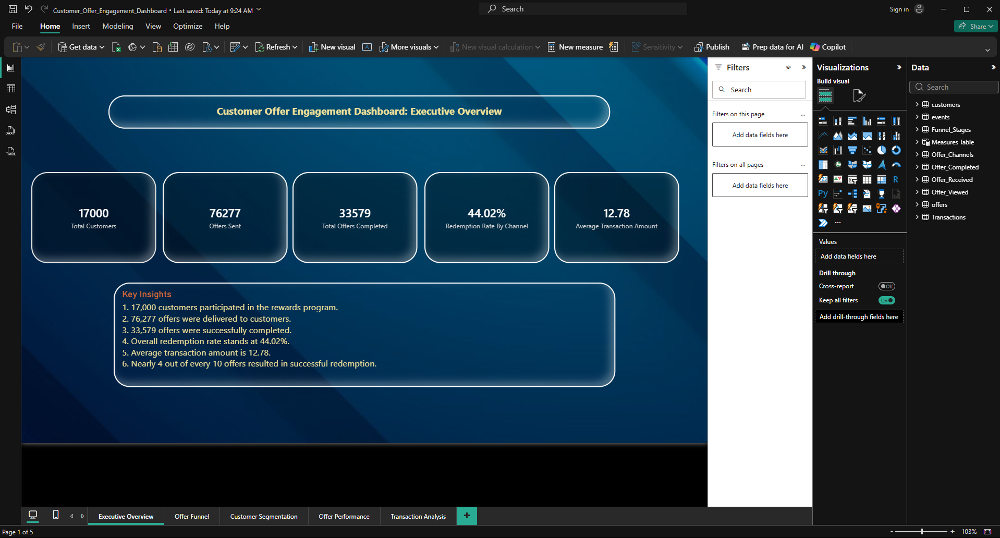
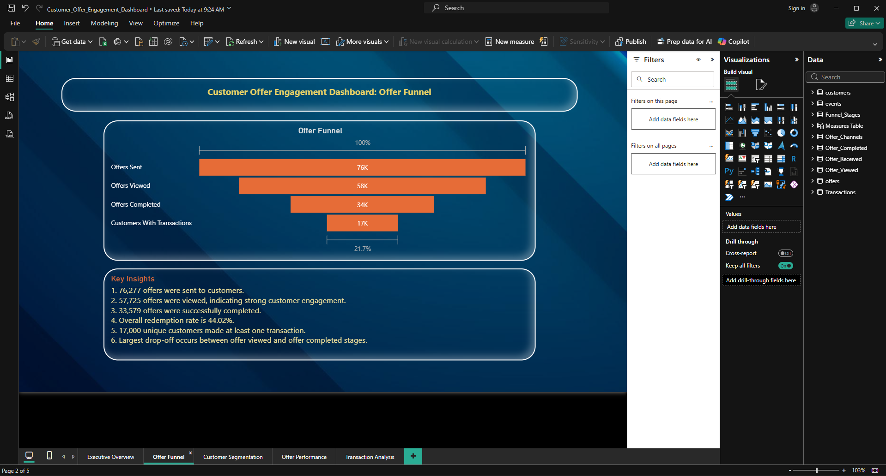
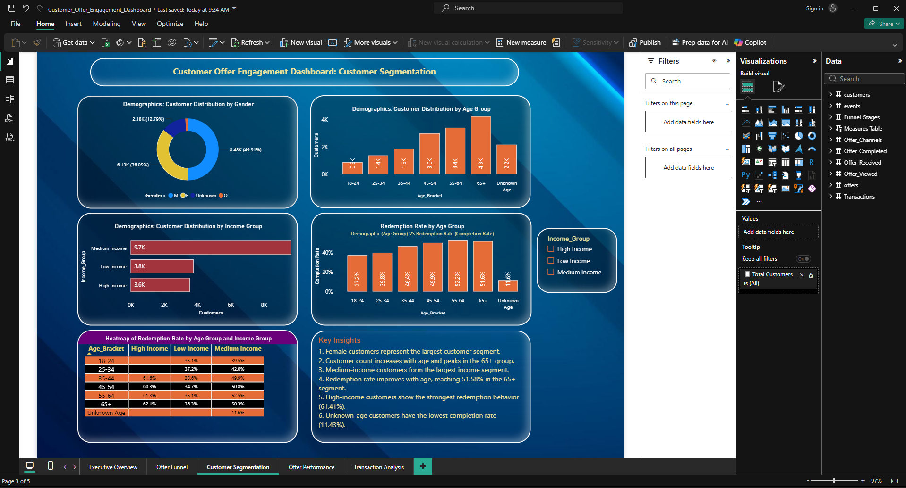
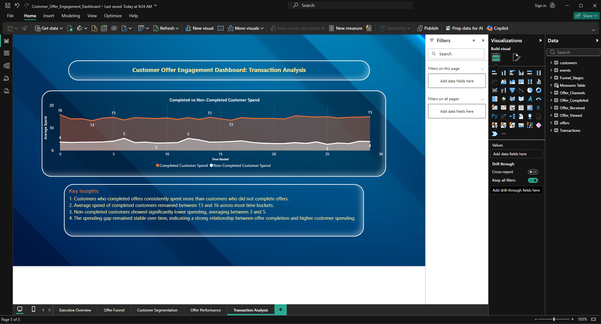

# Customer Offer Engagement Dashboard

## Project Overview

This Power BI project analyzes customer engagement and offer performance using customer, offer, transaction, and event data.

The dashboard helps identify:

- Which offer types perform best
- Customer offer redemption behavior
- Channel effectiveness
- Customer segmentation
- Spending patterns of customers who completed offers versus those who did not

The goal is to provide actionable insights that help improve offer strategies, customer engagement, and business performance.

---

## Tools Used

- Power BI
- Power Query
- DAX
- Data Modeling

---

## Dataset Information

The project uses four datasets:

- Customers
- Offers
- Events
- Transactions

Data was cleaned, transformed, and modeled inside Power BI before creating visualizations.

---

## Dashboard Pages

### 1. Executive Overview
High-level KPIs and overall offer performance.

### 2. Offer Funnel Analysis
Tracks the customer journey from offer received to completed.

### 3. Customer Segmentation
Analyzes customer groups by age, income, gender, and spending behavior.

### 4. Offer Performance
Evaluates offer types, rewards, channels, and completion rates.

### 5. Transaction Analysis
Compares spending patterns of customers who completed offers versus those who did not.

---

## Key Insights

- Discount offers achieved the highest redemption rate.
- Reward value 4 generated the strongest customer response.
- Web channel performed better than other communication channels.
- Higher offer difficulty reduced completion rates.
- Customers who completed offers spent significantly more than non-completers.

---

## Skills Demonstrated

- Data Cleaning
- Data Transformation
- Data Modeling
- DAX Measures
- KPI Development
- Dashboard Design
- Business Analysis
- Data Storytelling

---
## Dashboard Screenshots

### Executive Overview

### Offer Funnel

### Customer Segmentation

### Offer Performance

### Transaction Analysis

